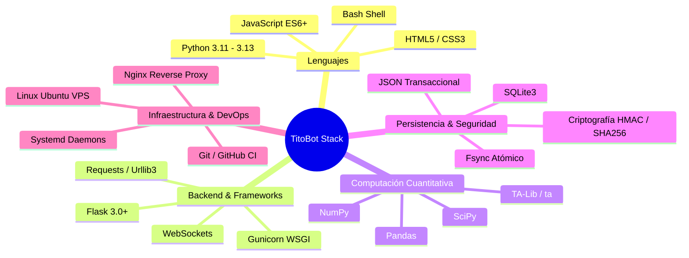
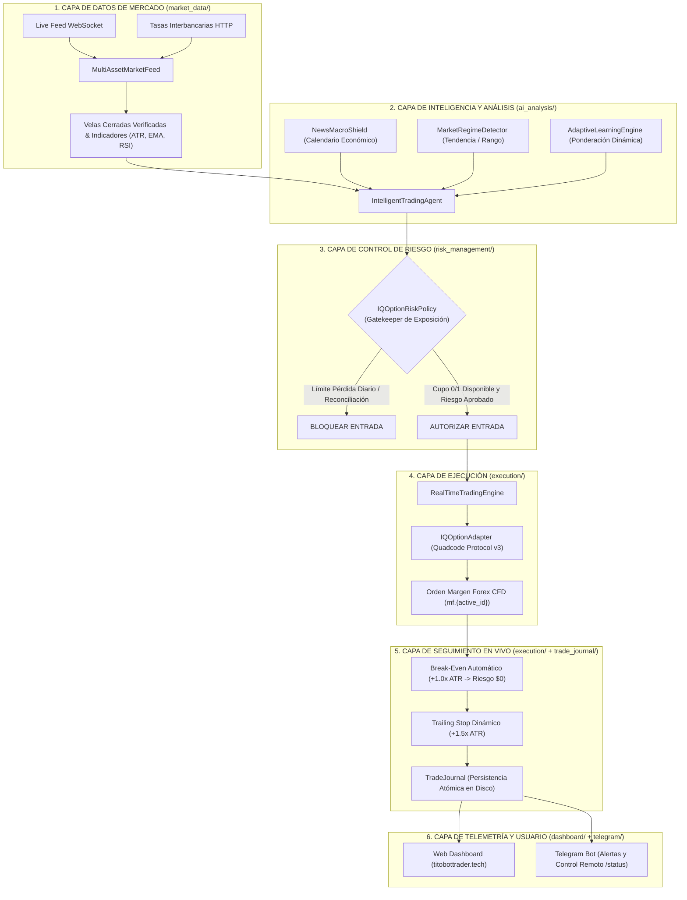
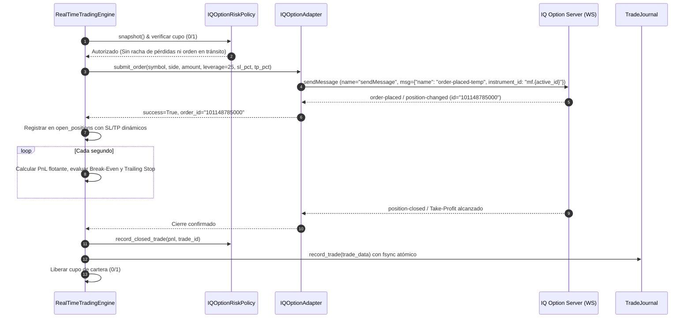

# 📘 DOCUMENTACIÓN TÉCNICA OFICIAL: TITOBOT TRADER
### Sistema Autónomo de Trading Cuantitativo y Operaciones de Margen

---

## 📑 ÍNDICE GENERAL

1. [Ficha Técnica y Resumen Ejecutivo](#1-ficha-técnica-y-resumen-ejecutivo)
2. [Stack Tecnológico y Lenguajes](#2-stack-tecnológico-y-lenguajes)
3. [Arquitectura del Sistema (Capas de Software)](#3-arquitectura-del-sistema-capas-de-software)
4. [Estrategia Cuantitativa y Modelo Matemático](#4-estrategia-cuantitativa-y-modelo-matemático)
5. [Ciclo de Vida de una Orden y Protocolo del Broker](#5-ciclo-de-vida-de-una-orden-y-protocolo-del-broker)
6. [Gestión de Riesgo Institucional y Tolerancia a Fallos](#6-gestión-de-riesgo-institucional-y-tolerancia-a-fallos)
7. [Control Remoto y Telemetría por Telegram](#7-control-remoto-y-telemetría-por-telegram)
8. [Estructura del Proyecto (Árbol de Archivos)](#8-estructura-del-proyecto-árbol-de-archivos)
9. [Manual de Despliegue y Mantenimiento en VPS](#9-manual-de-despliegue-y-mantenimiento-en-vps)

---

## 1. FICHA TÉCNICA Y RESUMEN EJECUTIVO

| Parámetro | Detalle |
| :--- | :--- |
| **Nombre del Proyecto** | **TitoBot Trader** (Autonomous Algorithmic Trading Platform) |
| **Versión** | **v2.5 (Stable CFD Release)** |
| **Dominio de Producción** | `titobottrader.tech` |
| **Broker Principal** | **IQ Option** (Protocolo WebSocket Quadcode v3.0) |
| **Modalidad Operativa** | **Trading de Margen Tradicional / Forex CFD** (SL/TP Dinámico sin expiración forzada) |
| **Mercados Admitidos** | **Forex** (Mayores y Cruces), **Materias Primas / Oro** (`XAUUSD`), **Wall Street Stocks** (`AAPL`, `TSLA`, `NVDA`), **Cripto** |
| **Entornos de Operación** | `PAPER` (Práctica/Demo verificada) y `LIVE_REAL` (Dinero Real) |
| **Infraestructura de Producción** | Ubuntu Linux VPS (Hostinger), Systemd Services, Gunicorn/Flask, SSL/TLS |

### Resumen Ejecutivo
**TitoBot Trader** es una plataforma autónoma de trading cuantitativo diseñada para operar en mercados financieros en tiempo real. Su núcleo operativo evalúa series temporales de precios mediante modelos estadísticos multivariables, matrices de confluencia técnica institucional y filtros de régimen de mercado. 

El sistema ejecuta operaciones de **Margen Tradicional (CFD)** con un ratio asimétrico de **Riesgo:Beneficio estricto de 1:2.0**, utilizando el indicador **Average True Range (ATR)** para calibrar dinámicamente el Stop-Loss y Take-Profit, complementado con **Break-Even automático (Riesgo Cero)** y **Trailing Stop de acompañamiento**.

---

## 2. STACK TECNOLÓGICO Y LENGUAJES



### Detalle de Tecnologías:
*   **Lenguaje Núcleo (Backend):** `Python 3.11 - 3.13` (Tipado estático con `typing`, concurrencia mediante `threading`, `asyncio` y sockets asíncronos).
*   **Cálculo Numérico & Indicadores:** `NumPy` y `Pandas` para manipulación vectorizada de series temporales; biblioteca `ta` para cálculo de indicadores estándar (RSI, ATR, EMA, Bollinger, MACD).
*   **Comunicación de Mercado en Tiempo Real:** `websocket-client` para conexión bidireccional persistente con el motor Quadcode de IQ Option (mensajes JSON de baja latencia).
*   **Interfaz de Usuario y Dashboard:** `Flask` como microframework web, plantillas `Jinja2`, `TailwindCSS` para estilos modernos y responsivos, y `Chart.js` para visualización de gráficos interactivos y telemetría de cotizaciones.
*   **Mensajería y Notificaciones:** `python-telegram-bot` / HTTP Telegram Bot API con soporte de comandos interactivos y polling seguro.
*   **Almacenamiento de Datos:**
    *   `trade_journal`: Registros persistentes en `JSON` y exportación tabular `CSV`.
    *   `iqoption_risk_policy`: Estado diario de PnL en `JSON` atómico mediante `tempfile.mkstemp` + `os.fsync` + `os.replace`.
    *   `users.db`: Base de datos `SQLite3` para autenticación de operadores web.
*   **Servicios del Sistema:** `Systemd` para gestión de procesos 24/7 con reinicio automático ante fallos y timers periódicos de respaldo.

---

## 3. ARQUITECTURA DEL SISTEMA (CAPAS DE SOFTWARE)

El sistema está estructurado bajo una **Arquitectura en Capas Desacopladas (Layered Architecture)**, lo que garantiza modularidad, mantenibilidad y tolerancia a fallos.



---

## 4. ESTRATEGIA CUANTITATIVA Y MODELO MATEMÁTICO

### 4.1 La Ecuación de la Esperanza Matemática
El sistema opera bajo el principio de **Esperanza Matemática Positiva ($E$)**:

$$E = (W \times R) - ((1 - W) \times 1)$$

Donde:
*   $W$: Tasa de Acierto (*Win Rate*).
*   $R$: Ratio Riesgo:Beneficio (*Risk-to-Reward Ratio*).

Al exigir un ratio mínimo de **$R = 2.0$**, el sistema no depende de altos porcentajes de acierto:
*   Con $W = 40\%$: $E = (0.40 \times 2.0) - (0.60 \times 1) = \mathbf{+0.20}$ (Ganancia Neta Sostenida).
*   Con $W = 50\%$: $E = (0.50 \times 2.0) - (0.50 \times 1) = \mathbf{+0.50}$ (Rendimiento Exponencial).

### 4.2 Calibración de Stop-Loss y Take-Profit por ATR
El ruido del mercado y el spread de compra/venta se neutralizan midiendo la volatilidad real del activo con el **Average True Range de 14 períodos ($ATR_{14}$)**:

$$TR = \max(High - Low, |High - Close_{prev}|, |Low - Close_{prev}|)$$
$$ATR_{14} = \frac{1}{14} \sum_{i=1}^{14} TR_i$$

*   **Para Compras (BUY / Long):**
    $$Stop Loss = Precio_{entrada} - (1.5 \times ATR_{14})$$
    $$Take Profit = Precio_{entrada} + (3.0 \times ATR_{14})$$
*   **Para Ventas (SELL / Short):**
    $$Stop Loss = Precio_{entrada} + (1.5 \times ATR_{14})$$
    $$Take Profit = Precio_{entrada} - (3.0 \times ATR_{14})$$

### 4.3 Filtro Institucional Macro: Regla de la EMA 200
Para evitar operar en contra de los grandes flujos de capital:
*   **Condición BUY:** Se exige $Precio \ge EMA_{200}$ y $EMA_{20} > EMA_{50}$.
*   **Condición SELL:** Se exige $Precio \le EMA_{200}$ y $EMA_{20} < EMA_{50}$.
*   Cualquier señal generada en contra de esta alineación recibe una penalización inmediata en su puntuación de confluencia.

### 4.4 Algoritmo de Break-Even y Trailing Stop
Una vez abierta la posición:
1.  **Fase Break-Even:** Al alcanzar $+1.0 \times ATR$ de ganancia flotante, el Stop-Loss se reubica en el precio de entrada (`entry_price`). El riesgo pasa a ser exactamente **\$0.00**.
2.  **Fase Trailing Stop:** Al superar $+1.5 \times ATR$, el Stop-Loss persigue el precio a una distancia de $1.2 \times ATR$, protegiendo el beneficio acumulado si el mercado gira repentinamente.

---

## 5. CICLO DE VIDA DE UNA ORDEN Y PROTOCOLO DEL BROKER



---

## 6. GESTIÓN DE RIESGO INSTITUCIONAL Y TOLERANCIA A FALLOS

1.  **Cupo Global Estricto (Single Position Limit):** El bot solo mantiene **1 posición abierta a la vez en toda la cartera**. No se dispersa capital ni se asumen riesgos acumulativos.
2.  **Persistencia Atómica Fsync:** Todas las escrituras de riesgo (`iqoption_risk_state.json`) y de historial (`trades_history.json`) utilizan archivos temporales y la llamada al sistema `os.fsync`. Si el servidor sufre un corte de energía o reinicio abrupto, **el archivo jamás se corrompe**.
3.  **Prevención de Órdenes Fantasma:** Antes de enviar una orden, se registra la intención. Si el proceso muere antes de recibir respuesta, el bot arranca en modo seguro exigiendo reconciliación y evitando duplicar exposiciones.
4.  **Escudo Macro de Noticias:** Monitoreo del calendario económico (`ff_calendar.xml`). Bloquea nuevas entradas 30 minutos antes y después de publicaciones de alto impacto (NFP, IPC, Tasas de Interés de Bancos Centrales).

---

## 7. CONTROL REMOTO Y TELEMETRÍA POR TELEGRAM

El bot integra un servicio de mensajería bidireccional mediante la API de Telegram:

| Comando | Función |
| :--- | :--- |
| **`/status`** | Informa el estado en vivo: Modalidad (`FOREX_CFD`), balance de la cuenta, PnL diario y detalle de posiciones abiertas (símbolo, dirección LONG/SHORT y PnL flotante). |
| **`/pause`** | Pausa de forma inmediata el escaneo de nuevas operaciones sin cerrar las posiciones activas en curso. |
| **`/resume`** | Reanuda el escaneo algorítmico (validando previamente que no existan bloqueos de riesgo o conciliaciones pendientes). |
| **`/report`** | Genera y envía un resumen detallado del historial de operaciones en formato CSV. |
| **`/stop`** | Parada de seguridad preventiva de todas las entradas. |

---

## 8. ESTRUCTURA DEL PROYECTO (ÁRBOL DE ARCHIVOS)

```
titobottrader/
├── main.py                          # Punto de entrada de la aplicación y servidor Flask
├── optimizer.py                     # Motor de investigación y calibración histórica
├── deploy_to_vps.sh                 # Script automatizado de despliegue a la VPS
├── setup_vps.sh                     # Instalador de dependencias y servicios systemd
│
├── ai_analysis/                     # Núcleo de Inteligencia Cuantitativa
│   ├── intelligent_agent.py         # Agente decisor multivariable (Confluencia, SL/TP)
│   ├── regime_detector.py           # Detector de régimen de mercado (Tendencia vs Rango)
│   ├── news_sentiment_shield.py     # Escudo macroeconómico de noticias de impacto
│   ├── economic_calendar.py         # Parser del calendario ForexFactory
│   └── adaptive_learning.py         # Motor de ponderación adaptativa y aprendizaje
│
├── execution/                       # Capa de Conexión y Motores de Trading
│   ├── trading_engine.py            # Motor principal de ejecución y trailing stop
│   ├── iqoption_adapter.py          # Conector WebSocket Quadcode v3 con IQ Option
│   └── binary_options_engine.py     # Motor secundario desacoplado de binarias
│
├── market_data/                     # Ingesta y Procesamiento de Precios
│   ├── market_feed.py               # Feed multiactivo (Forex, Oro, Acciones, Cripto)
│   └── live_provider.py             # Conector de cotizaciones interbancarias
│
├── risk_management/                 # Políticas y Barreras de Riesgo
│   ├── iqoption_risk_policy.py      # Gestor atómico de PnL diario y reconciliación
│   └── soros_manager.py             # Controlador de exposición y rachas
│
├── trade_journal/                   # Registro y Auditoría
│   ├── journal.py                   # Diario transaccional de operaciones (JSON/CSV)
│   └── report_exporter.py           # Exportador de reportes de rendimiento
│
├── telegram_service/                # Control Bidireccional
│   └── telegram_bot.py              # Handler de comandos y alertas Telegram
│
├── dashboard/                       # Servidor Web y Visualización
│   ├── web_dashboard.py             # Rutas API y controlador Flask
│   ├── templates/                   # Vistas HTML (index.html, admin.html)
│   └── static/                      # Recursos visuales (CSS, JS, Gráficos)
│
├── monitoring/                      # Monitoreo del Servidor VPS
│   ├── setup_telegram.py            # Configuración interactiva del token Telegram
│   └── titobot-*.service            # Archivos de unidad Systemd
│
├── tests/                           # Suite Completa de Pruebas (Pytest)
│   ├── test_forex_cfd_strict_guarantees.py
│   ├── test_cfd_demo_real_parity.py
│   ├── test_cfd_broker_close_parity.py
│   └── ... (Más de 250 pruebas automatizadas)
│
└── data/                            # Directorio Persistente de Datos
    ├── broker_config.json           # Configuración del broker y entorno activo
    ├── iqoption_risk_state.json     # Estado persistente de PnL diario (atómico)
    └── trades_history.json          # Historial de operaciones cerradas
```

---

## 9. MANUAL DE DESPLIEGUE Y MANTENIMIENTO EN VPS

### Comandos de Administración del Servicio en la VPS:

```bash
# 1. Ver el estado del servicio en tiempo real
sudo systemctl status titobot --no-pager

# 2. Reiniciar el bot (aplica cambios de código)
sudo systemctl restart titobot

# 3. Detener temporalmente el servicio
sudo systemctl stop titobot

# 4. Iniciar el servicio
sudo systemctl start titobot

# 5. Ver los logs de ejecución y escaneo de mercado en vivo
sudo journalctl -u titobot -f
```

### Actualización Sincronizada con GitHub:
Para descargar y desplegar las últimas mejoras desde el repositorio central:

```bash
cd /root/titobot || cd /opt/titobot
git fetch origin main
git reset --hard origin/main
sudo systemctl restart titobot
```

---
*Documentación oficial generada y certificada para TitoBot Trader.*
