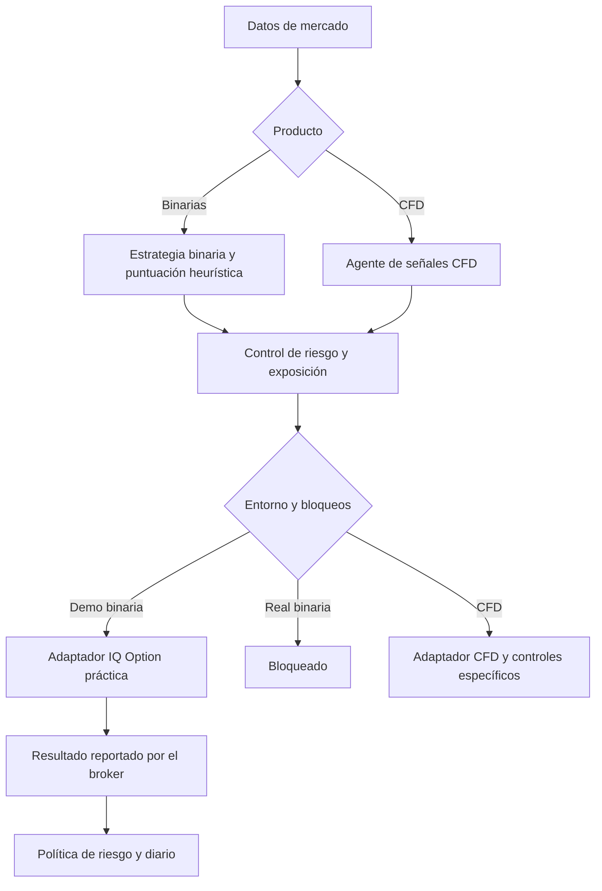
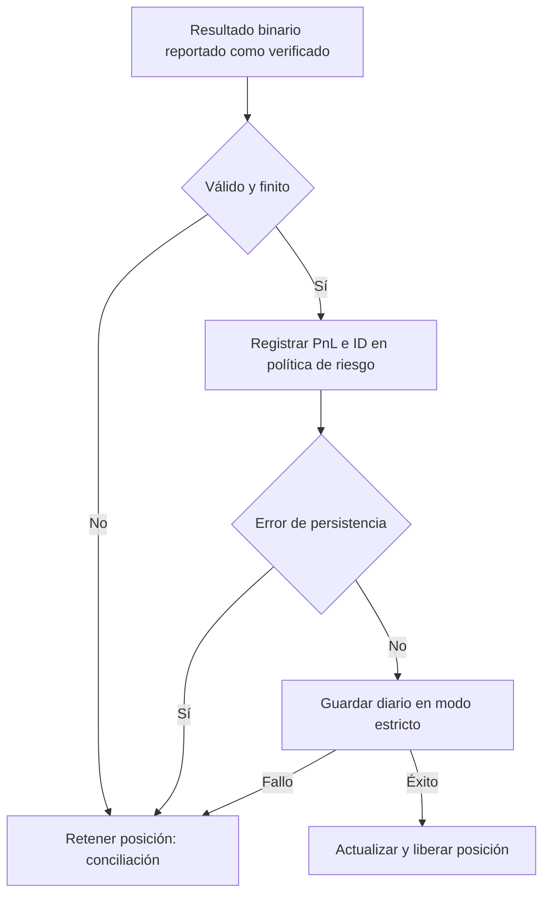

# Arquitectura y estado de implementación

**Estado: parcial, local y no desplegado. No apto para operar con dinero real.**

Ningún modelo de trading garantiza ganancias ni evita todas las pérdidas. Este documento describe lo que existe en el código local y separa los cambios implementados de los pendientes.

## Productos y entornos

Binarias y CFD son productos distintos y necesitan protocolos de ejecución y liquidación específicos. Para un mismo producto se busca compartir señales, ranking y reglas de riesgo entre Demo y Real, manteniendo las cuentas y sus estados separados. Las diferencias de ejecución y los bloqueos de seguridad siguen siendo explícitos: **la paridad completa todavía no está implementada ni verificada**.

El score binario es heurístico, **no una probabilidad calibrada**. Las pruebas de paridad comparan señales o argumentos con adaptadores simulados; no certifican aceptación, tamaño, costos ni liquidación en el broker.

## Cambios locales implementados

- `risk_management/iqoption_risk_policy.py`: conserva una conciliación pendiente al cargar un estado del día UTC anterior; expone el indicador de error de persistencia.
- `execution/binary_options_engine.py`: registra el resultado verificado en la política de riesgo antes de liberar la posición; trata excepciones de envío y éxitos sin confirmación o ID como estados inciertos, sin reintento automático. Los nuevos registros binarios usan fechas UTC con zona. La restauración del historial binario filtra por entorno y broker.
- `execution/trading_engine.py`: inyecta la política de riesgo al motor binario y elimina el registro redundante de PnL en `step`.
- `trade_journal/journal.py`: permite solicitar escritura estricta; el cierre binario la utiliza y requiere conciliación si recibe un fallo.
- `optimizer.py`: guarda candidatos en `experimental_optimizer_results.json`, separado de los parámetros activos, y no inventa tasas de acierto cuando faltan datos. Es exploración en muestra, no validación.
- `backtesting/settlement_report.py`: informe descriptivo sin red y de solo lectura; separa por un corte temporal explícito, excluye datos ambiguos y no modifica estrategias. No es un backtest ni una verificación independiente con el broker.

El diagrama describe la intención local, no una garantía transaccional. La persistencia de riesgo, diario JSON y CSV no es una sola transacción; no hay recuperación completa de todos los escenarios de interrupción.

## Patrones y componentes

- **Separación de responsabilidades**: feed de mercado, estrategias, adaptador de broker, política de riesgo y diario.
- **Inyección de dependencias**: el motor binario recibe la política de riesgo desde el motor principal.
- **Gatekeeper / fail-closed parcial**: la posición se retiene ante estados inciertos contemplados en las nuevas rutas. No está certificado para todas las caídas o reinicios.
- **Idempotencia por ID**: la política evita sumar dos veces un ID registrado dentro de su estado diario. La persistencia, el día de contabilización y el ámbito de cuenta requieren validación adicional.
- **Investigación aislada**: resultados del optimizador separados de parámetros operativos; el informe descriptivo no altera configuración.

## Modelos y evaluación

Las reglas actuales incluyen SMC, RSI, medias móviles, patrones de velas y filtros. Son heurísticas; no se ha demostrado una ventaja fuera de muestra para IQ Option. El optimizador histórico compara parámetros en muestra y no representa fielmente payout variable, costos, ejecución y expiración. La herramienta descriptiva de liquidaciones no evalúa señales hipotéticas, no implementa walk-forward y excluye fechas sin zona horaria.

## Pruebas y límites

La última ejecución focalizada registrada en esta sesión: **72 pruebas aprobadas**, sin conexiones de red, con adaptadores simulados. No es la suite completa ni certifica la integración en Demo o Real. Una ejecución ampliada anterior tuvo dos fallos en pruebas de exportación dependientes de un historial preexistente; deben aislarse y repetirse.

La marca `binary_order_pending` se guarda antes del envío y bloquea nuevas entradas tras un reinicio. Es una protección parcial: solo almacena un booleano y no permite reconstruir por sí sola la cuenta, el instrumento o el ID de la orden. Fallos sin evidencia explícita de no envío se tratan como inciertos y pueden requerir intervención manual. No se ha verificado su durabilidad ante pérdida de energía.

`scripts/audit_risk_history.py` compara historial y estado de riesgo sin escribirlos; exige cuenta explícita y una opción expresa para interpretar fechas antiguas sin zona. No concilia directamente con IQ Option ni reconstruye automáticamente el acumulado. El estado de riesgo todavía no está aislado por cuenta.

## Pendientes y bloqueos de despliegue

1. Diseñar persistencia durable y recuperación de intención, órdenes abiertas y liquidaciones ante caída en cada fase; cubrir errores de escritura, archivos corruptos y reinicios.
2. Conciliar cuidadosamente los cierres históricos que faltaron en el acumulado de riesgo; no reconstruir ni alterar automáticamente los datos del usuario.
3. Separar con seguridad el estado de riesgo por cuenta y verificar el cambio de entorno, incluida la restauración de todos los contadores.
4. Unificar y probar las rutas Demo/Real de ejecución y cierre por producto sin eliminar protecciones; CFD Demo todavía tiene rutas de PnL local distintas de la reconciliación Real y binarias Real permanece bloqueada.
5. Verificar el tamaño contractual, margen, SL/TP, costos, aceptación y liquidación con evidencia de IQ Option. Una simulación no demuestra comportamiento del broker.
6. Construir backtests con datos válidos del producto, costos, separación temporal, walk-forward y control de sobreajuste; evaluar candidatos sin promocionarlos automáticamente.
7. Completar monitorización de órdenes inciertas, datos obsoletos y controles de riesgo; el monitor actual no decide si es seguro operar en Real.
8. Ejecutar suite completa aislada, corregir fallos y hacer revisión de seguridad. Preparar despliegue con respaldo, conciliación y rollback solo después de validar Demo.

El último diagnóstico de la VPS encontró cierres Demo omitidos del acumulado de riesgo. **Los cambios de este documento no se han desplegado ni corrigen ese estado en el servidor.**
